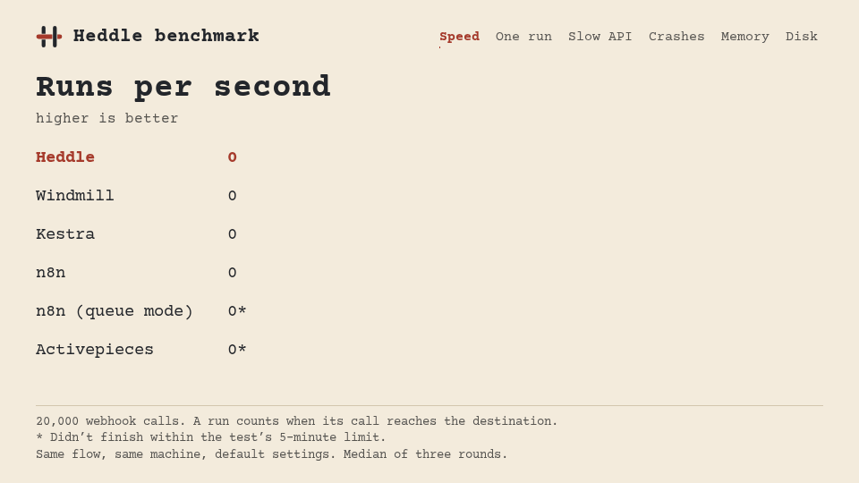

<p align="center">
  
</p>

<h2 align="center">Heddle</h2>

<p align="center">
  <em>The logic behind your business.</em>
</p>

<p align="center">
  <a href="https://hex.pm/packages/heddle"></a>&nbsp;
  <a href="https://heddlehq.github.io/website/docs/"></a>&nbsp;
  <a href="https://github.com/heddlehq/heddle/blob/main/LICENSE"></a>&nbsp;
  <a href="https://github.com/heddlehq/heddle/stargazers"></a>&nbsp;
  <a href="https://discord.gg/7zjnpna239"></a>
</p>

---

**Heddle** is a powerful, low-code workflow automation platform equipped with advanced no-code capabilities. Designed for reliability and scalability, it enables users to visually design, manage, and execute complex business logic and data processing flows in real-time.

Whether you are automating simple tasks or orchestrating complex microservices, Heddle provides the visual tools to build without boundaries.

## 🚀 Getting Started

Install Heddle with one line. Nothing else is required: it asks what you want, including your AI provider and whether to add [Treadle](https://github.com/heddlehq/Treadle), the terminal editor.

```bash
# Linux and macOS
curl -fsSL https://heddlehq.github.io/website/install.sh | sh
```

```powershell
# Windows
irm https://heddlehq.github.io/website/install.ps1 | iex
```

Then `heddle status`, `heddle logs -f`, `heddle doctor` and `heddle update` take it from there: `heddle --help` lists everything.

For servers and other options, see the **[Installation Guide](https://heddlehq.github.io/website/docs/start/installation/)**. For deployment topology and worker scaling, see [Scaling](https://heddlehq.github.io/website/docs/self-hosting/scaling/). To bring your team in, see [Workspaces and roles](https://heddlehq.github.io/website/docs/concepts/workspaces/).

Quick local start with Docker Compose:

```bash
docker compose up -d --build
```

Quick local start from source requires two terminals:

```bash
cd apps/heddle_ui
mix phx.server
```

```bash
cd apps/heddle_worker
mix run --no-halt
```

## ⚡ Benchmark

Same flow, same machine, default settings, against Windmill, Kestra, n8n and Activepieces.

<p align="center">
  
</p>

We wrote this test, and Heddle is in it, so everything is meant to be checked and rerun: see the [method and the raw data](benchmark/compare).

## 🤝 Community & Contributing

We believe in building in public. Join our community to discuss ideas, track our vision, or help us build:

- **Contributing**: Check our [Contributing Guide](CONTRIBUTING.md) to get started.
- **Public Roadmap**: Long-term vision and goals on our [Roadmap Repository](https://github.com/heddlehq/roadmap).
- **Project Board**: Live active tasks on our [GitHub Project Board](https://github.com/orgs/heddlehq/projects/2).
- **Discord Server**: Real-time chat and support in our [Discord Server](https://discord.gg/7zjnpna239).

## License

Heddle is open-source software licensed under the [MIT license](LICENSE).
